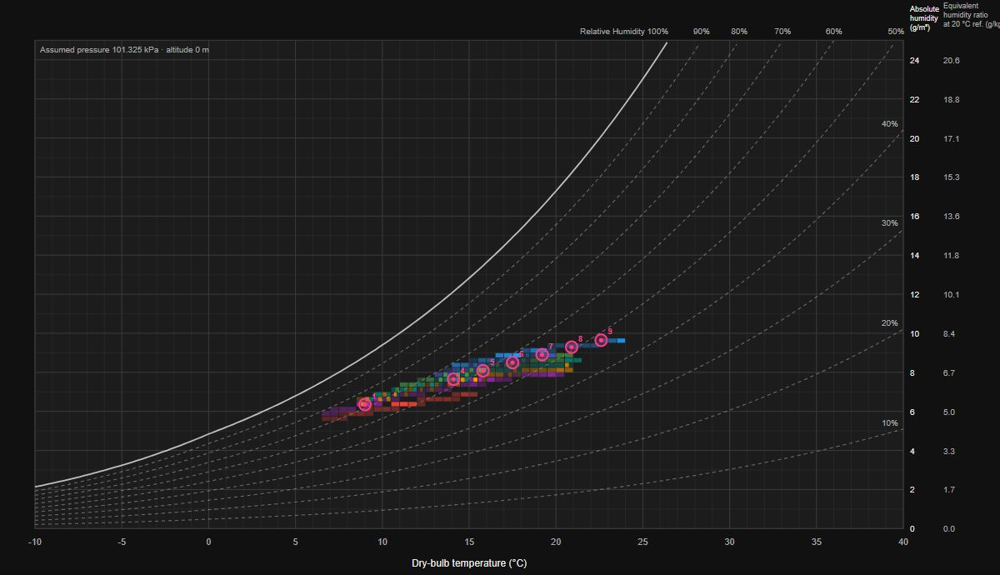
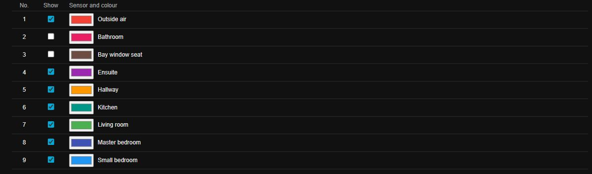

# Home Assistant Psychrometric Frequency Chart

An interactive Lovelace card that turns paired temperature and relative-
humidity recorder statistics into a psychrometric frequency heatmap.

The chart is designed for SwitchBot sensors but works with any Home Assistant
entities that expose temperature and relative humidity with recorder
statistics.

## Features

- Absolute humidity (g/m³) as the primary moisture coordinate.
- Equivalent humidity-ratio scale at a documented reference temperature.
- Relative-humidity curves labelled along the top and right boundaries.
- Frequency heatmap using either the original spectrum or persistent
  per-sensor colour gradients.
- Any number of dynamically numbered, independently selectable sensor pairs.
- Live numbered markers for every visible sensor.
- 1-day, 1-week, 1-month, 6-month, 12-month and custom date ranges.
- Dashboard controls for automatic temperature scaling, automatic humidity
  scaling, both axes together, persistent fixed custom bounds, or restoring
  the original configured scale.
- Five-minute recorder buckets for short periods and hourly buckets for longer
  periods.
- No third-party JavaScript dependencies and no helper entities.

## Screenshots

All screenshots below use deterministic synthetic demo data; no household
sensor history or identifying Home Assistant data is included.






## Before installation

You need one temperature entity and one relative-humidity entity for every air
location you want to plot. For example:

```text
sensor.outside_temperature
sensor.outside_humidity
```

The entities must:

- contain numeric temperature and relative-humidity readings;
- use degrees Celsius and percent relative humidity (0–100%);
- be included in Home Assistant Recorder; and
- expose statistics. In **Developer Tools → Statistics**, resolve any issue
  shown beside an entity before expecting historical data on the chart.

The live marker can appear as soon as both entities have states. The frequency
heatmap needs paired Recorder statistics, so a newly added sensor will populate
the chart gradually. The available history is limited by the statistics Home
Assistant has retained.

## Installation

Choose either the manual or HACS method. Do not install the JavaScript resource
twice.

### Method 1: manual installation

#### 1. Copy the card file into Home Assistant

1. Download
   [`psychrometric-chart-card.js`](psychrometric-chart-card.js) from this
   repository. On the GitHub file page, use **Download raw file**.
2. Open your Home Assistant configuration directory using the File editor,
   Samba, SSH, or another method you normally use to manage `/config`.
3. Create `/config/www` if it does not already exist.
4. Copy the downloaded file to:

   ```text
   /config/www/psychrometric-chart-card.js
   ```

5. If you created the `www` directory for the first time, restart Home
   Assistant once. Files under `/config/www` are served by Home Assistant under
   the `/local/` URL path.

> Files in `/config/www` are publicly retrievable by clients that can reach
> your Home Assistant server. This JavaScript file contains no credentials;
> never add passwords, tokens, or private entity data to it.

#### 2. Register the JavaScript resource

1. In Home Assistant, open **Settings → Dashboards**.
2. Open the three-dot menu in the upper-right corner and select
   **Resources**.
3. Select **Add resource**.
4. Enter the following URL:

   ```text
   /local/psychrometric-chart-card.js
   ```

5. Choose **JavaScript module** as the resource type and select **Create**.
6. Refresh the Home Assistant page. If the browser has cached an older copy,
   use `Ctrl+F5` on Windows/Linux or `Cmd+Shift+R` on macOS.

If your installation manages Lovelace resources in YAML, add this to the
`lovelace` section of `configuration.yaml` instead:

```yaml
lovelace:
  resource_mode: yaml
  resources:
    - url: /local/psychrometric-chart-card.js
      type: module
```

Then run the `lovelace.reload_resources` action or restart Home Assistant and
refresh the browser. The Resources page is not editable while
`resource_mode: yaml` is active.

Home Assistant's official
[resource-registration guide](https://contributors.home-assistant.io/frontend/custom-ui/resources/)
explains the `/config/www` to `/local/` mapping and both resource modes.

### Method 2: HACS custom repository

1. Open **HACS → Frontend** in Home Assistant.
2. Open the three-dot menu and select **Custom repositories**.
3. Add this repository URL:

   ```text
   https://github.com/randomname1212/home-assistant-psychrometric-chart
   ```

4. Select **Dashboard** as the category and add the repository.
5. Find **Psychrometric Frequency Chart** in HACS and select **Download**.
6. Refresh Home Assistant after HACS finishes. HACS should install and register
   the frontend resource automatically. Do not also register the manual
   `/local/` resource.

## Add the chart to a dashboard

### 1. Find your entity IDs

Open **Developer Tools → States** and locate the temperature and humidity
entities for each location. Copy the full entity IDs. Entity display names are
not sufficient; the configuration requires IDs such as
`sensor.outside_temperature`.

### 2. Add a Manual card

1. Open the dashboard that should contain the chart.
2. Open the dashboard menu and select **Edit dashboard**.
3. Select **Add card**.
4. Choose **Manual**. If **Psychrometric Frequency Chart** appears in the card
   picker, selecting it is also valid; use its code editor to enter the YAML.
5. Paste this minimal configuration and replace both example entity IDs with
   your own pair:

   ```yaml
   type: custom:psychrometric-chart-card
   title: Psychrometric frequency
   default_range: 12m
   default_colour_mode: original
   default_axis_mode: auto_both

   altitude: 0
   sea_level_pressure: 101.325
   humidity_ratio_reference_temperature: 20

   min_temperature: -10
   max_temperature: 40
   min_absolute_humidity: 0
   max_absolute_humidity: 25

   series:
     - name: Outside air
       temperature: sensor.outside_temperature
       humidity: sensor.outside_humidity
       color: "#f44336"
       default_visible: true
   ```

6. Select **Save** in the card editor, then save the dashboard.

For several locations, add more entries beneath `series`. Each entry must
contain a matching temperature/humidity pair:

```yaml
series:
  - name: Outside air
    temperature: sensor.outside_temperature
    humidity: sensor.outside_humidity
    color: "#f44336"
    default_visible: true
  - name: Living room
    temperature: sensor.living_room_temperature
    humidity: sensor.living_room_humidity
    color: "#4caf50"
```

The complete nine-sensor example is available in
[`examples/dashboard-card.yaml`](examples/dashboard-card.yaml). Add, remove,
or reorder series entries as required; the visible index numbers are generated
automatically.

### 3. Optional: give the chart a full-width view

The card works in an ordinary dashboard column, but the chart is easier to read
across a full view:

1. While editing the dashboard, create a new view or edit the current view.
2. Set its view/layout type to **Panel (one card)**.
3. Add the psychrometric chart as the only card in that view and save.

Panel mode is optional. Do not use it when the view must contain other cards.

## Updating a manual installation

1. Download the newest `psychrometric-chart-card.js`.
2. Replace `/config/www/psychrometric-chart-card.js` with the new file.
3. Refresh Home Assistant. If the old code remains cached, edit the resource
   URL to append or increment a version query, for example:

   ```text
   /local/psychrometric-chart-card.js?v=2
   ```

The query value is only a cache buster; it does not need to match a release
number. HACS users should update through HACS instead.

## Installation troubleshooting

- **Custom element does not exist:** confirm the resource URL, resource type
  (**JavaScript module**), filename, and `/config/www` location, then hard
  refresh the browser.
- **Live marker but no heatmap:** the live entity states exist, but paired
  Recorder statistics do not. Check **Developer Tools → Statistics**, Recorder
  inclusion, the selected date range, and that both members of the pair have
  data for the same periods.
- **No live marker:** check both entity IDs in **Developer Tools → States** and
  confirm their states are numeric rather than `unknown` or `unavailable`.
- **Values appear implausible:** confirm temperature is in °C, humidity is a
  percentage, and the configured altitude/pressure describes the site.
- **Resource appears twice:** remove either the HACS resource or the manual
  `/local/` resource so the card is loaded only once.

## Configuration

| Option | Default | Purpose |
| --- | --- | --- |
| `series` | required | Temperature/humidity entity pairs. |
| `default_range` | `12m` | Initial range: `1d`, `1w`, `1m`, `6m`, `12m`, or `custom`. |
| `default_colour_mode` | `original` | `original` spectrum or `sensor` gradients. |
| `default_axis_mode` | `auto_both` | Initial scale: `auto_both`, `auto_temperature`, `auto_humidity`, `fixed`, or `default`. |
| `altitude` | `0` | Site altitude in metres. |
| `sea_level_pressure` | `101.325` | Sea-level pressure in kPa. |
| `pressure` | calculated | Optional explicit station pressure in kPa. |
| `humidity_ratio_reference_temperature` | `20` | Reference temperature used only for the equivalent secondary scale. |
| `min_temperature` / `max_temperature` | `-10` / `40` | Fixed/fallback horizontal limits in °C. |
| `min_absolute_humidity` / `max_absolute_humidity` | `0` / `25` | Fixed/fallback primary vertical limits in g/m³. |
| `temperature_bin` | `0.5` | Histogram temperature resolution in °C. |
| `absolute_humidity_bin` | `0.25` | Histogram moisture resolution in g/m³. |

Each `series` entry supports:

```yaml
- name: Outside air
  temperature: sensor.outsideair_temperature
  humidity: sensor.outsideair_humidity
  color: "#f44336"
  default_visible: true
```

Colour choices made in the card are saved in browser storage and Home
Assistant per-user frontend data.

Axis mode and fixed custom bounds are selected directly in the card and saved
in browser storage. In a single-axis automatic mode, the other axis retains
its configured fixed limits. Automatic bounds use the selected sensors and
active history period, with padding so observations do not touch the frame.
Selecting **Default scale (original)** immediately restores the Lovelace
`min_*`/`max_*` limits without deleting the user's saved custom limits.

## Understanding the secondary scale

Absolute humidity measures water-vapour mass per air volume (g/m³), while
humidity ratio measures water-vapour mass per dry-air mass (g/kg). Converting
between the two requires temperature and pressure.

The rightmost axis is therefore explicitly labelled as an **equivalent**
humidity ratio at the configured reference temperature (20 °C by default).
That reference applies only to the straight secondary axis. Individual samples
and tooltip calculations use their actual recorded or bin-centre temperature.

## Data and privacy

The card reads Home Assistant recorder statistics through the authenticated
frontend WebSocket connection. It does not send sensor data to an external
service.

## Inspiration and acknowledgements

The visual approach was inspired by Dr. Andrew J. Marsh's interactive
[Psychrometric Chart](https://drajmarsh.bitbucket.io/psychro-chart2d.html),
particularly its psychrometric curves and temperature/humidity frequency grid.
The reference page and screenshots supplied during the initial design session
were used as visual inspiration. This Home Assistant card is an independent
implementation and does not include or redistribute code or assets from that
project.

Thanks also to the Home Assistant project and its recorder/statistics APIs,
which provide the historical data used by the card.

## Licence

MIT — see [`LICENSE`](LICENSE).


