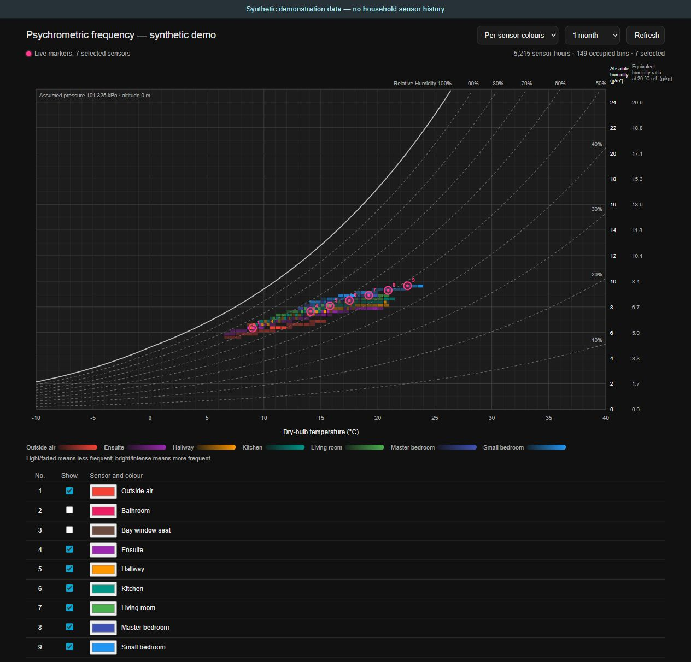

# Home Assistant Psychrometric Frequency Chart

An interactive Lovelace card that turns paired temperature and relative-
humidity recorder statistics into a psychrometric frequency heatmap.

The chart is designed for SwitchBot sensors but works with any Home Assistant
entities that expose temperature and relative humidity with recorder
statistics.

## Features

- Absolute humidity (g/m³) as the primary moisture coordinate.
- Equivalent humidity-ratio scale at a documented reference temperature.
- Relative-humidity curves labelled along the top and right boundaries.
- Frequency heatmap using either the original spectrum or persistent
  per-sensor colour gradients.
- Any number of dynamically numbered, independently selectable sensor pairs.
- Live numbered markers for every visible sensor.
- 1-day, 1-week, 1-month, 6-month, 12-month and custom date ranges.
- Dashboard controls for automatic temperature scaling, automatic humidity
  scaling, both axes together, persistent fixed custom bounds, or restoring
  the original configured scale.
- Five-minute recorder buckets for short periods and hourly buckets for longer
  periods.
- No third-party JavaScript dependencies and no helper entities.

## Screenshots

All screenshots below use deterministic synthetic demo data; no household
sensor history or identifying Home Assistant data is included.




## Installation

### Manual

1. Copy [`psychrometric-chart-card.js`](psychrometric-chart-card.js) to
   `/config/www/psychrometric-chart-card.js`.
2. In Home Assistant, open **Settings → Dashboards → Resources**.
3. Add `/local/psychrometric-chart-card.js` as a **JavaScript module**.
4. Add a manual Lovelace card using
   [`examples/dashboard-card.yaml`](examples/dashboard-card.yaml).
5. Replace the example entity IDs with your own temperature/humidity pairs.
6. Reload the browser, using `Ctrl+F5` if an earlier version was cached.

### HACS custom repository

This repository also includes `hacs.json`, allowing it to be added as a HACS
custom **Dashboard** repository. Release packaging can be added when the first
tagged release is created.

## Configuration

| Option | Default | Purpose |
| --- | --- | --- |
| `series` | required | Temperature/humidity entity pairs. |
| `default_range` | `12m` | Initial range: `1d`, `1w`, `1m`, `6m`, `12m`, or `custom`. |
| `default_colour_mode` | `original` | `original` spectrum or `sensor` gradients. |
| `default_axis_mode` | `auto_both` | Initial scale: `auto_both`, `auto_temperature`, `auto_humidity`, `fixed`, or `default`. |
| `altitude` | `0` | Site altitude in metres. |
| `sea_level_pressure` | `101.325` | Sea-level pressure in kPa. |
| `pressure` | calculated | Optional explicit station pressure in kPa. |
| `humidity_ratio_reference_temperature` | `20` | Reference temperature used only for the equivalent secondary scale. |
| `min_temperature` / `max_temperature` | `-10` / `40` | Fixed/fallback horizontal limits in °C. |
| `min_absolute_humidity` / `max_absolute_humidity` | `0` / `25` | Fixed/fallback primary vertical limits in g/m³. |
| `temperature_bin` | `0.5` | Histogram temperature resolution in °C. |
| `absolute_humidity_bin` | `0.25` | Histogram moisture resolution in g/m³. |

Each `series` entry supports:

```yaml
- name: Outside air
  temperature: sensor.outsideair_temperature
  humidity: sensor.outsideair_humidity
  color: "#f44336"
  default_visible: true
```

Colour choices made in the card are saved in browser storage and Home
Assistant per-user frontend data.

Axis mode and fixed custom bounds are selected directly in the card and saved
in browser storage. In a single-axis automatic mode, the other axis retains
its configured fixed limits. Automatic bounds use the selected sensors and
active history period, with padding so observations do not touch the frame.
Selecting **Default scale (original)** immediately restores the Lovelace
`min_*`/`max_*` limits without deleting the user's saved custom limits.

## Understanding the secondary scale

Absolute humidity measures water-vapour mass per air volume (g/m³), while
humidity ratio measures water-vapour mass per dry-air mass (g/kg). Converting
between the two requires temperature and pressure.

The rightmost axis is therefore explicitly labelled as an **equivalent**
humidity ratio at the configured reference temperature (20 °C by default).
That reference applies only to the straight secondary axis. Individual samples
and tooltip calculations use their actual recorded or bin-centre temperature.

## Data and privacy

The card reads Home Assistant recorder statistics through the authenticated
frontend WebSocket connection. It does not send sensor data to an external
service.

## Inspiration and acknowledgements

The visual approach was inspired by Dr. Andrew J. Marsh's interactive
[Psychrometric Chart](https://drajmarsh.bitbucket.io/psychro-chart2d.html),
particularly its psychrometric curves and temperature/humidity frequency grid.
The reference page and screenshots supplied during the initial design session
were used as visual inspiration. This Home Assistant card is an independent
implementation and does not include or redistribute code or assets from that
project.

Thanks also to the Home Assistant project and its recorder/statistics APIs,
which provide the historical data used by the card.

## Licence

MIT — see [`LICENSE`](LICENSE).


